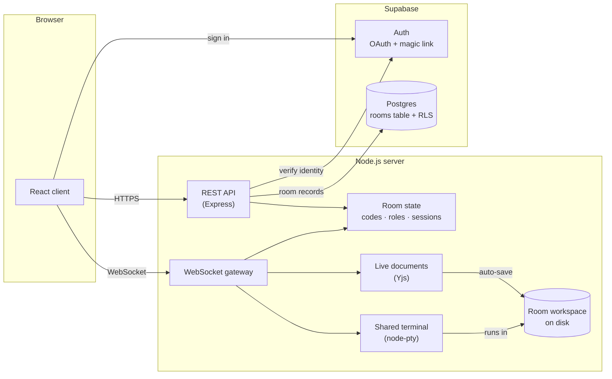

# VScode.io

**A browser-based, VS Code-style collaborative IDE for student teams.**

Create a room, share a six-character code, and your whole team is coding in the same files
at the same time, with live cursors, a shared terminal, and no Git setup or installs.

---

## Why it exists

Group projects usually stall before any code is written: someone can't get Git working,
someone's laptop can't run the toolchain, and merge conflicts eat the first hour of every
session. VScode.io removes all of that. Everyone opens a browser tab, joins a room, and
works in one shared workspace that looks and feels like VS Code.

## Features

### Rooms you join with a code
- Any signed-in user can create a room and becomes its **owner**.
- The room shows a **6-character team code that rotates every 30 seconds**, with a
  countdown ring. A code stays valid for a short grace window after it rotates, so a teammate
  who's halfway through typing it isn't locked out.
- Codes skip look-alike characters (`0/O`, `1/I`), so they're easy to read off a projector.

### Real-time collaborative editing
- Built on **Monaco**, the same editor component that powers VS Code. Multi-cursor,
  minimap, find/replace, bracket matching, format document and the F1 command palette all
  behave exactly as they do in VS Code.
- Edits merge conflict-free in real time (CRDTs via **Yjs**), so two people typing on the
  same line never overwrite each other.
- Every collaborator's **cursor and selection appear live in their own color**, labeled
  with their name.
- A presence bar shows who's in the room and who's online right now.

### A shared terminal
- Each room has **one bash terminal that everyone sees**. When someone runs a command, the
  whole team watches the output stream in.
- It's set up for the languages students actually use: **C/C++, Python, Java, Node.js, Go,
  Rust, Ruby and PHP**, plus everyday tools like git, curl, make and editors.
- Reconnecting replays recent output, so a page reload doesn't leave you staring at a blank
  terminal.

### Roles and access control
| Role | Can view | Can edit files | Can type in terminal | Can manage people |
|---|:-:|:-:|:-:|:-:|
| **Owner** | ✓ | ✓ | ✓ | ✓ |
| **Editor** | ✓ | ✓ | ✓ | |
| **Viewer** | ✓ | | | |

- Everyone joins as a **viewer**. Viewers can click **Request edit access**, and the owner gets
  a live approve/deny banner.
- From **Manage access**, the owner can promote or demote anyone, **kick** someone (which
  disconnects them instantly), or **close the room** for everyone.
- Permissions are enforced **on the server**, not only by hiding buttons. A viewer's edits
  and keystrokes are dropped before they ever reach the shared document or the shell.

### Workspace tools
- **File explorer** with nested folders, plus create, rename and delete.
- **Download ZIP** of the whole workspace at any time. Bulky regenerable folders like
  `node_modules`, `.git` and `.venv` are left out.
- **8 themes** that re-color the entire app, not just the editor: Dark+, Light+, Monokai,
  Dracula, One Dark, Solarized Dark, GitHub Dark and Night Owl. Your choice is saved to your
  account.
- **Honest loading screen.** The steps *Connecting → Preparing workspace → Syncing files*
  each light up only when that step has actually finished, never on a timer.

### Sign-in
GitHub, Google, or an email magic link, handled by **Supabase Auth**.

### Room lifecycle
Rooms are designed for working sessions, not permanent storage. A room that nobody has open
for **2 hours** is cleaned up automatically, and owners can close a room whenever they like.
The ZIP export means nothing important needs to stay on the server.

---

## How it works



- **Two kinds of token.** A Supabase token proves *who you are*. A short-lived token signed
  by the server proves *which room you're in*. Your role is never stored in either token. It
  is looked up live on every request, so a kick or a role change takes effect immediately,
  even on connections that are already open.
- **One live document per file.** Every open file is its own Yjs document, synced over
  WebSockets and auto-saved to the room's folder on disk a moment after typing stops. A
  separate per-room channel carries presence, cursors and edit-access requests.
- **One process, one port.** REST and WebSocket traffic share a single Node.js server, which
  keeps live room state in memory. Each stateful piece (rooms, documents, terminals,
  connections) sits behind a small interface, so it can later move to Redis to run across
  several servers.
- **No privileged database key.** The server writes to Postgres *as the signed-in user*, so
  Supabase's row-level security stays in force even for the server's own requests.

## Security at a glance

- Every REST call and WebSocket connection is verified independently. The server never
  trusts a user ID that the client sends.
- No secrets reach the browser. The client only ever receives the public Supabase anon key.
- File paths are checked so nothing can read or write outside its own room's folder.
- Rate limits guard joining (against code guessing), creating rooms, edit requests and
  exports. Request bodies, WebSocket messages, file counts and file sizes are all capped.
- The terminal gets a clean environment with no server secrets in it, and on Linux it runs
  as a non-root user with process and CPU limits.
- **Known limit:** a shared shell on a server is inherently powerful. The protections reduce
  the risk but can't eliminate it, so VScode.io is meant for class and team projects, not
  for running untrusted code from strangers.

## How it compares to VS Code

VScode.io is **inspired by** VS Code. It is not a clone. The editor itself *is* VS Code's
Monaco, but the surrounding features differ:

| Area | VScode.io | VS Code |
|---|---|---|
| Language smarts | Monaco's built-in support (TS/JS, JSON, CSS, HTML) | Language servers for every language |
| Extensions | None | Full marketplace |
| File tree | Refreshes every few seconds | Updates instantly |
| Search / Source control panels | Visual only | Fully functional |
| Debugging, tasks, multi-root workspaces | Not included | Built in |
| Collaboration | **Built in, no setup** | Needs Live Share |

## Tech stack

| Layer | Technologies |
|---|---|
| Client | React 18, TypeScript, Vite, Tailwind CSS, Monaco Editor, xterm.js |
| Collaboration | Yjs, y-websocket, y-monaco |
| Server | Node.js, Express, ws, node-pty, TypeScript (strict) |
| Auth & database | Supabase (Auth + Postgres with row-level security) |
| Testing | Vitest, Supertest |
| Packaging | npm workspaces (`client`, `server`, `shared`), Docker |

## Project layout

```
client/     React app: pages, editor, terminal, themes
server/     API, WebSocket gateway, rooms, terminal, workspace files
shared/     TypeScript types used by both client and server
supabase/   Database schema (rooms table + security policies)
```
