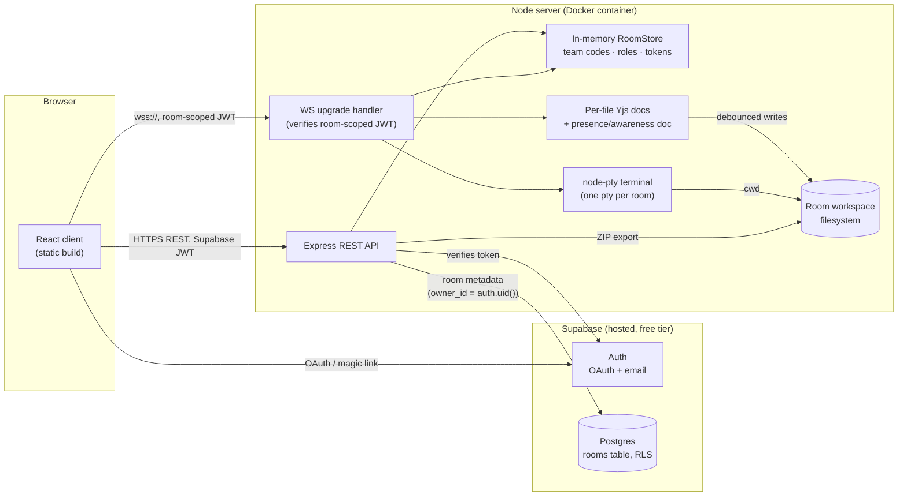

# SyncCode

A browser-based, VS Code-style collaborative IDE for student teams. Join a room with a
rotating team code and code together in real time — no Git required.

> **Status:** All 7 planned milestones are done. This is a complete, working project, not a
> stub — see **Known limitations & VS Code parity** below for an honest list of what's
> genuinely like VS Code versus what isn't, and **Security** for what's actually been verified
> versus reasoned-through-but-untested.

**Contents:** [Architecture](#architecture) · [Monorepo layout](#monorepo-layout) ·
[Local setup](#local-setup) · [Supabase setup](#supabase-setup) ·
[Deployment](#deployment-free-tiers) · [Security](#security) ·
[Known limitations & VS Code parity](#known-limitations--vs-code-parity) ·
[Testing guide, by milestone](#testing-guide-by-milestone)

## Architecture



**Why this shape:**
- **The client never talks to Postgres directly except through RLS.** The server writes room
  metadata as the signed-in user's own Supabase session (`supabaseForUser`, see Security) —
  there's no service-role key anywhere in this system, so a bug in the server's own logic
  can't bypass row-level security to read/write another user's data.
- **Two independent token types, intentionally.** A Supabase JWT proves *identity* (who you
  are); a short-lived, server-signed "room token" proves *room membership* (which room, and —
  looked up live, never baked into the token — what role). Splitting these means a kick or a
  role change takes effect on an already-open connection without reissuing anything.
- **Room state is deliberately in-process memory, not Postgres or Redis**, per the spec: one
  server instance for now, with every stateful piece (`RoomStore`, the Yjs doc registry, the
  terminal registry, the connection registry) built behind a small interface specifically so a
  Redis-backed implementation could replace the in-memory one later without touching callers.
- **One Node process serves both REST and WebSocket traffic** on the same HTTP server (a
  manual `'upgrade'` handler, not a separate WS port) — this is what needs a host that keeps a
  single long-lived process alive, not a stateless serverless/Lambda-style function.

## Monorepo layout

- `client/` — React + TypeScript + Vite + Tailwind
- `server/` — Node + Express + ws, TypeScript strict
- `shared/` — TypeScript types shared by both
- `supabase/migrations/` — SQL to run once in your Supabase project's SQL editor

## Local setup

1. Install dependencies from the repo root (npm workspaces):
   ```
   npm install
   ```
   `server` and `client` both resolve `@synccode/shared` through its compiled output
   (`shared/dist`), not its TypeScript source directly, so it has to be built before anything
   else will typecheck or run — `npm run dev`/`typecheck`/`test`/`build` at the root all build
   it first automatically. If you run a workspace script directly (`npm run dev -w server`)
   and see "Cannot find module '@synccode/shared'", run `npm run build -w shared` once first.
2. Copy env templates and fill in your Supabase project values:
   ```
   cp client/.env.example client/.env
   cp server/.env.example server/.env
   ```
3. Run both apps:
   ```
   npm run dev
   ```
   - Client: http://localhost:5173
   - Server: http://localhost:4000

## Supabase setup

1. **Auth providers:** in your Supabase project → Authentication → Providers, enable GitHub
   and/or Google, and set each provider's callback URL to
   `https://<your-project>.supabase.co/auth/v1/callback`. Email sign-in (magic link) works
   out of the box.
2. **Database schema (required for M2+):** open the SQL editor in your Supabase project and
   run `supabase/migrations/0001_rooms.sql`. This creates the `rooms` table (room metadata
   only — the rotating code and connected participants live in server memory) with row-level
   security so a user can only see/create rows where they're the owner.

## Deployment (free tiers)

**Free-tier terms change constantly — the numbers below are a snapshot taken while writing
this guide, not a promise. Check each provider's current free-tier page before you commit to
one**, especially: whether a credit card is required, current RAM/CPU/bandwidth caps, and
whether the free tier still exists at all (some providers quietly remove or shrink them).

### Client — Vercel, Netlify, or Cloudflare Pages

All three have a genuinely free static-hosting tier as of writing, with no meaningful
differences for this app. Pick whichever you already have an account on.

1. Connect the repo, set the project root to `client/`.
2. Build command: `npm install && npm run build` (run from `client/`, or
   `npm run build -w client` from the repo root if the platform builds from the root).
3. Output directory: `client/dist`.
4. Environment variables: `VITE_SUPABASE_URL`, `VITE_SUPABASE_ANON_KEY` (same project as the
   server), `VITE_API_URL` = your deployed server's URL (step below).
5. The anon key is safe to ship in this bundle by design (see Security) — it is not a secret.

### Server — needs a host that keeps one long-lived process alive

This is the constrained part. The server holds WebSocket connections and in-memory room state
in a single Node process — it is **not** a fit for a stateless/serverless function platform
(Vercel/Netlify functions, AWS Lambda, Cloudflare Workers) regardless of their free tiers,
because those platforms don't guarantee one process stays alive to hold a WebSocket open or
your `RoomStore` in memory between requests. You need a host that runs a persistent
container/VM.

**Checked three candidates while writing this guide (verify again before you deploy — this is
exactly the kind of thing that changes without notice):**

- **Render** — still has a genuine always-free tier (750 instance-hours/month per workspace)
  that fits this app's shape. It **sleeps the container after 15 minutes with no inbound
  traffic** and wakes on the next request in roughly a minute — which is exactly the cold
  start the loading screen (M6) is built to show honestly rather than hide. Of the three, this
  is the one actually worth using today.
- **Fly.io** — as of writing, **it no longer has an ongoing free tier**, only a one-time trial
  (a couple of Machine-hours or 7 days). Not a fit for keeping this running for a semester.
- **Railway** — its "free" plan is $0 base plus only **$1/month of usage credit**, which reads
  as a trial, not a sustainable free tier for an always-on WebSocket server (1 vCPU / 0.5GB
  RAM even on a paid starter plan).

None of these three pricing pages fully confirmed Dockerfile support or WebSocket support in
writing for their specific free tier — both are standard enough features that they almost
certainly work, but "almost certainly" is exactly the kind of assumption this guide is telling
you not to take on faith. Deploy once and actually test a WebSocket connection before relying
on it.

- `server/Dockerfile` is ready to go (build command: `docker build -f server/Dockerfile .`
  from the repo root — note the build context is the **repo root**, not `server/`, so it can
  reach `shared/`). **Caveat:** this Dockerfile has been reasoned through and its install/build
  steps verified outside Docker (no Docker daemon was available while building this project),
  but not actually run through `docker build`/`docker run`. Do that yourself before trusting it.
- Set env vars from `server/.env.example` — at minimum `SUPABASE_URL`, `SUPABASE_ANON_KEY`,
  `ROOM_TOKEN_SECRET` (generate a real one: `openssl rand -base64 48` — never reuse the
  repo's local-dev value), and `CORS_ORIGIN` set to your deployed client's exact URL (no
  trailing slash).
- Expose/forward port `4000` (or override `PORT`).
- **Free tiers on these hosts commonly sleep the container after a period of no traffic**,
  meaning the first request after a quiet spell pays a real cold-start cost (seconds, not
  milliseconds, while the container boots and the Node process starts). The loading screen
  (M6) is what makes this tolerable — "Connecting" will just sit active for longer than usual
  on a cold start, honestly reflecting what's actually happening, instead of a fake progress
  bar completing before the server is really there.
- **The container's filesystem is typically ephemeral** on free tiers (wiped on redeploy or
  restart) — room workspaces are meant to be short-lived already (idle cleanup, M6) and the
  ZIP export exists specifically so nothing valuable only lives there, but don't expect a
  room's files to survive a server restart on most free hosts.

### Supabase

The free tier (hosted Postgres + Auth) is normally enough for this project's actual load —
confirm current limits (database size, monthly active users, auth rate limits) on Supabase's
own pricing page before relying on it for anything beyond a demo/class project.

## Security

A straight account of what's enforced, how it's tested, and what's explicitly out of scope —
written for someone deciding whether to trust this with real student data, not just to check a
box.

**Identity & tokens**
- Every REST call and WS upgrade independently verifies the caller — the server never trusts
  a client-asserted user ID (`middleware/supabaseAuth.ts`, `services/roomToken.ts`).
- Room-scoped tokens carry `userId`/`roomId`/`tokenId` only — **not** a role. Role is resolved
  live from `RoomStore` on every request, so a kick, a role change, or a revoke takes effect on
  an already-open connection immediately, without reissuing tokens or forcing a reconnect.
  Verified in `roleEnforcement.test.ts`, `terminalEnforcement.test.ts`, and a live two-client
  smoke test (M4's README section has the details, including a real bug that test caught).
- A kick force-closes every open WebSocket connection for that user immediately
  (`ws/connectionRegistry.ts`), not just the next REST call.

**No secrets reach the client.** The client bundle contains only `VITE_`-prefixed values —
Vite doesn't expose anything else by design, and the Supabase anon key is meant to be public
(RLS is the real access control, not key secrecy). Verified by actually building the client
and grepping the output for `ROOM_TOKEN_SECRET`'s value and the string `service_role` — neither
appears. Server logs were also audited: every `console.*` call was checked by hand, and none of
them print a token, team code, or secret value, only error messages and non-sensitive IDs.

**Enforcement is server-side, not hidden UI.** A viewer's Yjs document updates and terminal
input are dropped at the WebSocket message layer before ever touching shared state or
reaching another client — confirmed with unit tests that feed real encoded protocol messages
into the actual connection handlers (not mocks), not just by hiding buttons in the React tree.

**Path traversal.** Every file operation resolves through one function
(`workspaceFs.resolveSafePath`) that rejects absolute paths, `..` segments, and null bytes, and
re-validates the resolved path is still inside the room's workspace directory. Covered by
`workspaceFs.test.ts` with traversal attempts via both `/` and `\` separators.
  - **Known, accepted gap:** this does not resolve symlinks. A user with terminal access
    (owner/editor) could create a symlink pointing outside the workspace, then "open" it
    through the file explorer as if it were a normal file. This is **not treated as a
    privilege escalation** in this app's threat model: anyone with terminal access already has
    direct shell access to read/write anything the server process can — a symlink trick grants
    them nothing they couldn't already do by typing a command. A viewer (who can't use the
    terminal or create files) has no path to exploit this. If this app's roles ever change
    such that a lower-privilege role gets terminal or file-create access without shell access,
    this gap would need revisiting with a `realpath`-based check.

**Rate limiting.** Every mutating endpoint that could plausibly be abused has its own limiter
on top of a baseline 120 req/min/IP across the whole API: joining a room (per-user + per-IP,
guards against team-code brute-forcing), creating a room, requesting edit access, and
exporting a ZIP. All covered by tests that actually trip the limiter (not just check it's
configured).

**Input validation & size limits.** Room names (1–60 chars), file counts
(`MAX_FILES_PER_ROOM`), file sizes (`MAX_FILE_SIZE_BYTES`, oversized writes are truncated with
a logged warning rather than silently accepted), REST body size (1MB via `express.json`), and
WebSocket frame size (`WS_MAX_PAYLOAD_BYTES`, added during this review — `ws` defaults to a
generous 100MiB per frame, which is an easy memory-pressure DoS otherwise) are all capped.
Room/participant counts are capped too (`MAX_ROOMS_PER_USER`, `MAX_TOTAL_ROOMS`,
`MAX_PARTICIPANTS_PER_ROOM`).

**Transport & headers.** `helmet()` on every response; CORS locked to a single explicit origin
(`CORS_ORIGIN`), not a wildcard — credentialed requests from anywhere else are rejected by the
browser before they reach the app.

**The terminal is the honest exception to all of the above.** Running arbitrary shell commands
on a shared server is inherently risky no matter how it's sandboxed. See "Terminal safety" in
the M5 testing section below for the full account, including what's actually been verified
versus reasoned-through-but-untested (the POSIX-only ulimit/non-root code path couldn't be
exercised on the Windows machine this was built on).

**What hasn't been through a real security audit.** This review was done by the same person
(well — the same model) who wrote the code, which is a real limitation: I know what I built,
which biases what I think to check. Nothing here has been through a third-party penetration
test or a tool like `npm audit` run with intent to fix everything it flags (the existing
`npm audit` output has been triaged — see commit history — but only for issues in packages
actually reachable from this app's own code paths, not exhaustively). Treat this as a solid
foundation for a class project, not a cleared-for-production audit.

## Known limitations & VS Code parity

SyncCode is **inspired by** VS Code's look and feel — activity bar, file explorer, tabs,
status bar, command palette, themes — built on the real Monaco editor (the same editor
component VS Code itself uses). It is explicitly **not** a VS Code clone, and these are the
concrete gaps, not marketing hedging:

| Area | What SyncCode does | What real VS Code does |
|---|---|---|
| IntelliSense | Monaco's built-in TS/JS/JSON/CSS/HTML language smarts only | Full language servers per-language via extensions |
| Extensions | None — the feature set here is fixed | A full extension marketplace |
| Search/Source Control/Extensions activity-bar icons | Present but inert (visual only, clearly disabled) | Fully functional |
| File tree updates | REST-polled every ~4s | Instant, filesystem-watcher-driven |
| File rename/delete UI | Browser `prompt()`/`confirm()` dialogs | Inline rename, proper delete confirmation UI |
| Settings | One setting (theme), stored in your Supabase profile | A deep, searchable settings system |
| Multi-root workspaces, debugging, tasks.json, etc. | Not implemented | Core features |

Everything else — multi-cursor, minimap, find/replace, format-document, bracket matching,
command palette (F1) — is Monaco's own real implementation, not a reimplementation, so it
behaves exactly like VS Code's because it *is* the same editor component.

## Testing guide, by milestone

Each milestone below has a short, specific checklist — not "click around and see if it feels
right," but the actual real-state transitions and server-side enforcement to look for.

### M1

- Sign in on `/login` with GitHub, Google, or email → should land on `/dashboard`.
- `/dashboard` calls `GET /api/auth/me` on the server, which independently verifies the
  Supabase access token (not just trusting the client) and echoes back the verified user.
- Visiting `/dashboard` while signed out redirects to `/login`.

### M2

- `npm run typecheck` / `npm run test` — as before; the server suite now covers team-code
  rotation + the grace window, participant caps, kick-invalidates-token, and the full
  create → join → kick HTTP flow (Vitest + Supertest, Supabase calls mocked).
- Sign in, then on `/dashboard` click **Create room**. You should land on `/room/:id` as the
  owner, see a 6-character code with a 30-second countdown ring, and be able to copy it.
- Open the room URL in a private/incognito window, sign in as a second account, go to `/join`,
  and enter the code. That user lands in the same room as a **viewer** and shows up in the
  owner's participant list.
- Wait 30+ seconds and copy the code again — it should have changed. A code copied just before
  rotation should still work for a few seconds after (the grace window), but a code from two
  rotations ago should be rejected.
- Leaving a room (or being kicked — see M4 below) invalidates that browser's room session —
  reloading `/room/:id` without rejoining redirects to `/join`.
- Hammering `/join` with a wrong code more than ~8 times in a few minutes from the same
  account should start returning "Too many join attempts."

### M3

- Open a room as the owner, create a file from the explorer (`+File`, e.g. `notes.md`), and
  type in it. Open the same room URL in a second browser/profile as a second user (an editor,
  or an approved viewer — see M4 below) and confirm you see the other person's edits and
  cursor appear live in the same file, labeled with their color.
- The presence avatar row (top of the editor) should show a green dot for whoever is actually
  connected right now, independent of the room's full participant list.
- Create a nested file (e.g. `src/app.ts`), confirm the folder appears automatically; rename
  and delete both work and show up for the other browser within a few seconds (the file tree
  polls, it isn't push-updated yet).
- Reload the page with a file open — its content should come back from the server (it's
  persisted to disk, debounced ~500ms after you stop typing), not reset to blank.
- A quick way to get a second identity to test with locally: sign up a second account via
  email magic-link in a private browser window.

### M4

- Join a room as a second account (viewer by default). Monaco should be read-only for them,
  and clicking **"Read-only — request edit access"** (top bar) sends a request.
- As the owner, a banner should appear ("X is requesting edit access") within a second or two
  — this is pushed live over the same WebSocket used for presence, not polled. Approve it: the
  viewer's editor should flip to editable within ~5s (the next room-state poll), **without
  them reloading or rejoining**.
- Open **"Manage access"** (owner only, top-right) to see every participant with a role
  dropdown and a Kick button. Changing someone's role or kicking them takes effect
  immediately for the owner's view; the affected user notices within the next poll/WS message.
- Kicking someone force-closes their open editor/presence WebSocket connections immediately
  (not just their next REST call) — they're booted out, not just locked to read-only.
- **Enforcement is server-side, not just hidden buttons:** a viewer's Yjs edits are dropped at
  the WebSocket layer before they're ever applied to the shared document or broadcast to
  anyone else — confirmed with both a unit test (`roleEnforcement.test.ts`, feeding crafted
  protocol messages into the real connection handler) and a live two-client smoke test against
  the running server (not committed, but it's what caught a real bug: y-websocket's cross-tab
  BroadcastChannel optimization will silently bypass the server entirely if you test two
  clients in the same process/tab without `disableBc: true` — worth knowing if you write
  similar tests later).
- Cursor/selection broadcasting and seeing others' presence are **not** treated as mutations —
  a viewer's cursor still shows up for everyone, only content edits are blocked.

### M5

- Open a room, toggle the terminal open (top bar, **"Hide/Show terminal"** — visible to
  everyone), and as the owner run a real command: `node -v`, `echo hello`, or (if the tools
  exist on whatever machine runs the server) `npm install` / `python --version`. Output
  streams live over its own WebSocket, separate from the editor's.
- Open the same room as a second (viewer) account: they should see the **same shared
  terminal's output** (it's one pty per room, not one per person) but typing does nothing —
  the panel shows "Read-only" and keystrokes never reach the shell, even from a tampered
  client (enforced the same way as M4: a live `canWrite()` check per message, not a hidden
  input box).
- Reload the page with the terminal open: prior output (scrollback) replays so you're not
  staring at a blank panel — it isn't re-running anything, just replaying what already
  happened.
- Idle timeout is set to 2 minutes in the local `.env` (intentionally short for testing — use
  something like 20 minutes in production). Leave a room's terminal untouched that long and
  the next command fails/the pty exits; reopening the panel starts a fresh shell.

#### Terminal safety — what's actually enforced, and where

- **Environment scrubbing (verified):** the pty's environment is a from-scratch allow-list
  (`PATH`, a scoped `HOME`/`TEMP` inside the room's own workspace, `TERM`, etc.) — never a
  filtered copy of `process.env`. `SUPABASE_*`, `ROOM_TOKEN_SECRET`, and everything else the
  server holds are structurally absent, not just unset.
- **Role enforcement (verified):** covered by `terminalEnforcement.test.ts` (feeds real
  protocol messages into the connection handler) and a live smoke test against the running
  server — a viewer's `input`/`resize` messages never reach the shell.
- **Idle timeout (verified):** a periodic sweep kills any room's pty past
  `TERMINAL_IDLE_TIMEOUT_MS` of no input/output activity.
- **Non-root execution, ulimit-based CPU/memory/process caps:** implemented (POSIX branch of
  `terminalManager.ts` wraps the shell in `ulimit -v/-u/-t` before exec'ing it, and will drop
  to `TERMINAL_UID`/`TERMINAL_GID` if set), but **this dev machine is Windows, which has
  neither concept** — so this code path has only been typechecked and reasoned through, not
  run for real. It needs verification on the Linux container built in M7, where it actually
  matters. Said plainly rather than claimed as tested.
- **Running arbitrary shell commands on a shared server is still a real risk** even with all
  of the above — a determined attacker with edit access could still try to exhaust CPU/disk,
  attempt a container escape, or abuse the server's outbound network access for anything from
  cryptomining to scanning other hosts. The mitigations here reduce blast radius; they don't
  eliminate it. Anyone deploying this for real should also consider: outbound network
  restrictions, a per-room or per-session CPU/wall-clock quota enforced at the container
  level (not just ulimits), and treating every room's workspace as untrusted after the fact.

### M6

- **Themes:** open the picker (top-right of the dashboard, or inside a room) and switch
  through all 8 — Dark+, Light+, Monokai, Dracula, One Dark, Solarized Dark, GitHub Dark,
  Night Owl. Confirm it re-colors the *whole app* (landing-style chrome, panels, buttons),
  not just the Monaco editor — that was the actual point of this milestone's "applies to the
  whole UI" requirement, not a nice-to-have. Sign out and back in (or reload): your last
  choice should come back, because it's saved to your Supabase user profile
  (`user_metadata.theme`), not just `localStorage`.
  - Dracula/Monokai/Solarized Dark/GitHub Dark/Night Owl are the real theme JSON files from
    the `monaco-themes` project, vendored directly into
    `client/src/features/theme/monacoThemes/` rather than taken as an npm dependency — the
    spec names both options as acceptable. **One Dark isn't in that bundle**, so it's a
    hand-written theme definition matching the well-known Atom One Dark palette (a color
    scheme, not copyrightable code) — said plainly since it's the one theme here that isn't a
    direct port of an existing file.
- **Loading screen:** open a room and watch the three steps light up in order — Connecting →
  Preparing workspace → Syncing files. These are wired to real calls (`GET /api/rooms/:id`,
  the file tree endpoint, and a live Yjs WS handshake), not a timer — you can see this by
  throttling your network in devtools and watching a step visibly sit in its "active" state
  until the real request finishes, rather than ticking on a fixed schedule.
- **ZIP export:** click **"Download ZIP"** (visible to every role, including viewers, since
  it's read-only). Confirm the download contains your files, and that a `node_modules`
  directory (if you `npm install`ed something in the terminal) is excluded — regenerable
  clutter, not something worth shipping in a student's download.
- **Manual room close:** as the owner, open **"Manage access" → "Close room for everyone…"**.
  Everyone else's connection should drop immediately (not just time out), and the room code
  stops working — there's nothing left to rejoin.
- **Idle cleanup:** `ROOM_IDLE_TIMEOUT_MS` is set to 2 minutes locally for testing (use
  something like 7200000 — 2 hours — in production). Create a room, then close every tab that
  has it open (no open editor/presence/terminal connection from anyone). Wait a bit over 2
  minutes; the room and its workspace directory should be gone — confirmed by Vitest with a
  mocked timeout rather than an actual 2-minute wait, but worth seeing for real once. Idleness
  is measured by **connection presence, not keystrokes** — an open-but-AFK tab still polls the
  server every few seconds, so counting that as "activity" would have meant a room could never
  idle out as long as one browser tab was merely left open.

### M7

- `npm run typecheck && npm run test` from the repo root — 3 workspaces typecheck clean, 42
  server tests pass (team-code rotation/grace window, token invalidation, role enforcement for
  both the editor and the terminal, path-traversal, rate limiting on join/create-room/export,
  room lifecycle). This milestone didn't add a separate test suite — it's the point where all
  the testing from M2 onward adds up to real coverage, plus a handful of new tests for the
  rate limiter and WS payload cap added during the security pass.
- Read the **Security** section above critically, not as a pass/fail checklist — it's written
  to tell you what's actually been verified (built the client, grepped the bundle for secrets)
  versus what's reasoned-through-but-untested (the POSIX terminal sandboxing, the Dockerfile
  itself — no Docker daemon was available in the environment this was built in).
- If you have Docker locally: `docker build -f server/Dockerfile -t synccode-server .` from
  the repo root, then `docker run --env-file server/.env -p 4000:4000 synccode-server` and hit
  `http://localhost:4000/api/health`. This is genuinely unverified by me — please do this and
  tell me what breaks, if anything.
- Open this README on GitHub and confirm the Architecture Mermaid diagram actually renders
  (GitHub renders Mermaid natively in Markdown; some other renderers don't).
